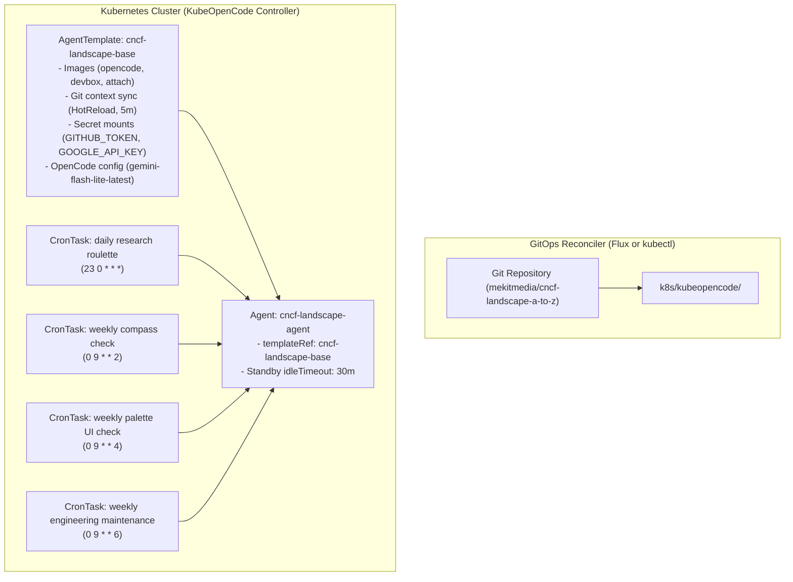

# KubeOpenCode Agent Templates & GitOps Automation

## Overview

This repository uses **[KubeOpenCode](https://github.com/kubeopencode/kubeopencode)** to run autonomous AI coding agents inside Kubernetes. The system is declarative, Kubernetes-native (`apiVersion: kubeopencode.io/v1alpha1`), and managed via GitOps building blocks.

Rather than configuring individual agents or scheduled GitHub Actions from scratch, configuration is centralized in an **AgentTemplate** and orchestrated through **CronTasks**.

---

## Architecture & Building Blocks



---

## Directory Structure

```
k8s/
├── kustomization.yaml                               # Root kustomization entrypoint
└── kubeopencode/
    ├── kustomization.yaml                           # Component kustomization aggregating all resources
    ├── agent-template.yaml                          # Shared base template for the CNCF Landscape project
    ├── agents.yaml                                  # Persistent or live agent definitions
    ├── crontask-project-research.yaml               # CNCF Landscape project research task (daily)
    ├── crontask-compass-audit.yaml                  # Compass alignment and backlog audit task
    ├── crontask-palette-review.yaml                 # Palette UI/UX and accessibility review task
    └── crontask-engineering-maintenance.yaml        # Engineering codebase maintenance task
```

---

## Deployment & Usage

### 1. Direct Apply via `kubectl`

You can apply the building blocks directly to any cluster running KubeOpenCode:

```bash
# Apply all KubeOpenCode building blocks
kubectl apply -k k8s/kubeopencode/

# Or via the root k8s folder
kubectl apply -k k8s/
```

### 2. GitOps Reconciliation via Flux

To sync these building blocks continuously using Flux from your cluster management repository, define a Flux `GitRepository` and `Kustomization`:

```yaml
apiVersion: source.toolkit.fluxcd.io/v1
kind: GitRepository
metadata:
  name: cncf-landscape-a-to-z
  namespace: flux-system
spec:
  interval: 5m
  url: https://github.com/mekitmedia/cncf-landscape-a-to-z.git
  ref:
    branch: main
---
apiVersion: kustomize.toolkit.fluxcd.io/v1
kind: Kustomization
metadata:
  name: cncf-landscape-agents
  namespace: flux-system
spec:
  interval: 10m
  path: ./k8s/kubeopencode
  prune: true
  sourceRef:
    kind: GitRepository
    name: cncf-landscape-a-to-z
  targetNamespace: kubeopencode
```

Flux will monitor this repository, apply the `AgentTemplate`, create the `Agent`, and register the scheduled `CronTasks`.

---

## Available Scheduled Tasks (`CronTask`)

> [!NOTE]
> Tasks are intentionally named by **purpose and domain** rather than schedule cadence (`daily`, `weekly`, etc.) so that schedules can be modified freely without renaming Kubernetes resources or GitOps references.

| CronTask Name | Manifest File | Schedule | Purpose |
|---|---|---|---|
| **`cncf-project-research`** | `crontask-project-research.yaml` | `23 0 * * *` (Daily) | Draws next pending or roulette task, conducts research, validates schema |
| **`cncf-compass-audit`** | `crontask-compass-audit.yaml` | `0 9 * * 2` (Tue 09:00 UTC) | Reviews tool gaps, letter progression, and category indexes |
| **`cncf-palette-review`** | `crontask-palette-review.yaml` | `0 9 * * 4` (Thu 09:00 UTC) | Reviews website theme accessibility, focus states, navigation |
| **`cncf-engineering-maintenance`** | `crontask-engineering-maintenance.yaml` | `0 9 * * 6` (Sat 09:00 UTC) | Runs test suite, verifies schemas, refactors technical debt |

---

## Manual Trigger & Control

You can trigger any `CronTask` immediately via kubectl without waiting for its schedule:

```bash
# Trigger an immediate run of the project research CronTask
kubectl annotate crontask cncf-project-research kubeopencode.io/trigger=true -n kubeopencode

# Suspend a CronTask
kubectl patch crontask cncf-project-research -n kubeopencode --type merge -p '{"spec":{"suspend":true}}'

# Resume a CronTask
kubectl patch crontask cncf-project-research -n kubeopencode --type merge -p '{"spec":{"suspend":false}}'
```

---

## Domain Memory & Skills Discovery

- **Skills**: KubeOpenCode automatically discovers skills in the workspace root at `.opencode/skills/` (and `.agents/skills/`). The `cncf-weekly-content` skill is immediately available to all agents.
- **Domain Memory**: Long-term technical patterns and guardrails are recorded under `docs/domain-memory/`:
  - `docs/domain-memory/palette.md`: UI layout, accessibility semantics, Hugo templates.
  - `docs/domain-memory/content.md`: Project quote grounding, tracker normalization.
  - `docs/domain-memory/engineering.md`: Pydantic schemas, testing fixtures, CLI validation.
