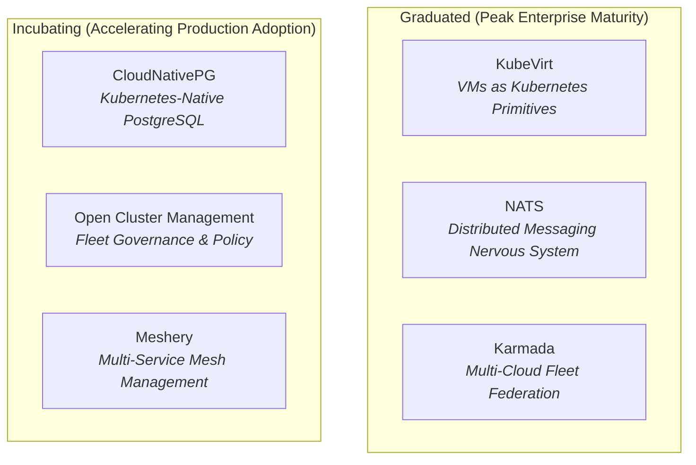
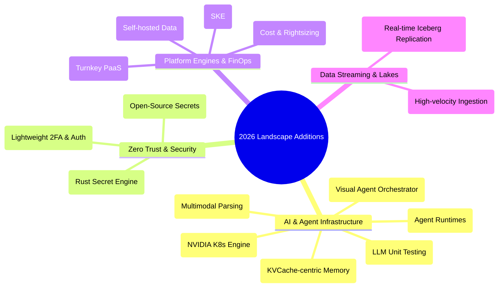

As 2026 draws to a close, the Cloud Native Computing Foundation (CNCF) landscape stands at a profound inflection point. 

For much of the past decade, cloud native was defined by the container wars, the establishment of Kubernetes as the undisputed orchestrator, and the hardening of service meshes and declarative continuous delivery. In 2026, however, the narrative shifted dramatically. 

This year was marked by two tectonic forces:
1. **The Infrastructure Graduation Wave**: Foundational technologies that bridge classical enterprise architectures with cloud-native paradigms—from virtual machines to distributed messaging and multi-cluster federation—reached peak maturity and graduated.
2. **The AI & Autonomous Agent Influx**: The CNCF landscape emerged as the essential substrate for Generative AI, with specialized memory architectures for LLM serving, agentic execution environments, and evaluation frameworks becoming first-class citizens.

At the same time, healthy ecosystems require renewal. 2026 saw pioneering projects reach the end of their lifecycle, formally archiving repositories and passing the torch to modern cloud-native successors.

Here is our comprehensive 2026 retrospective on what was added, what graduated, and honorable mentions for the projects that retired.

---

## 🏆 The Graduated Class of 2026 & Key Promotions

Graduation from the CNCF is the highest badge of production readiness, stability, and open governance. In 2026, several cornerstone projects crossed this finish line, while others gained critical momentum by advancing to Incubating status.

### 1. KubeVirt (Graduated)
Perhaps no milestone in 2026 was more significant for enterprise platform teams than the formal **graduation of [KubeVirt](https://kubevirt.io/)**. 

For years, enterprises faced a hard architectural dichotomy: run containers on Kubernetes, and run legacy monolithic workloads on proprietary hypervisors (like VMware vSphere). KubeVirt shattered that barrier by enabling teams to run virtual machines directly within Kubernetes pods, managed via standard Custom Resource Definitions (`VirtualMachine`, `VirtualMachineInstance`). With its 2026 graduation, KubeVirt proved that virtualization is no longer an alternative to Kubernetes—it is a workload on top of it.

### 2. NATS (Graduated)
Distributed systems in 2026 look nothing like the monolithic queues of a decade ago. **[NATS](https://nats.io/)** officially attained graduated status, solidifying its place as the ultra-fast, multi-tenant distributed pub/sub and streaming nervous system. Whether coordinating edge computing nodes, powering microservices, or connecting autonomous AI agent swarms across clouds, NATS provides the sub-millisecond, low-overhead messaging infrastructure that modern cloud native demands.

### 3. Karmada (Graduated)
As single-cluster topologies gave way to multi-cloud and hybrid fleet deployments, **[Karmada](https://karmada.io/)** graduated to become the standard for multi-cluster Kubernetes management. By preserving native Kubernetes API semantics, Karmada allows organizations to build applications as if they are targeting a single cluster, while automatically federating, replicating, and scheduling workloads across regions and cloud providers.

### 4. Incubating Promotions: CloudNativePG, OCM, and Meshery
- **[CloudNativePG](https://cloudnative-pg.io/) (Sandbox → Incubating)**: The debate over whether to run primary transactional databases in Kubernetes was decisively settled in 2026. CloudNativePG proved that declarative, operator-driven PostgreSQL with automated failover, WAL archiving, and zero-downtime upgrades delivers superior operational velocity compared to managed cloud databases.
- **[Open Cluster Management (OCM)](https://open-cluster-management.io/) (Sandbox → Incubating)**: OCM solidified modular cluster fleet orchestration, providing declarative policy enforcement and placement rules across thousands of spoke clusters.
- **[Meshery](https://meshery.io/) (Sandbox → Incubating)**: Advanced as the multi-mesh lifecycle manager, enabling platform teams to benchmark, visualize, and operate Istio, Linkerd, and Envoy configurations from a single pane of glass.

---

## 🚀 The New Wave: 2026 Landscape Additions

Throughout 2026, the CNCF landscape expanded rapidly to address the operational realities of artificial intelligence, Zero Trust identity, and platform engineering.

### 1. The Generative AI & Autonomous Agent Surge
The biggest category shift in 2026 was the influx of AI infrastructure tools tailored for containerized environments:

- **[Mooncake](https://github.com/kvcache-ai/Mooncake)**: As Large Language Model context windows grew and multi-turn agent conversations multiplied, GPU memory bottlenecks emerged as a critical cost and latency driver. Mooncake entered the landscape as a KVCache-centric memory and storage architecture, disaggregating prefill and decoding phases to dramatically scale LLM serving throughput.
- **[DeepEval](https://github.com/confident-ai/deepeval)**: Exploding past 19,000 GitHub stars, DeepEval entered the landscape to solve a critical operational challenge: production evaluation and regression testing for LLMs and agent pipelines. DeepEval brings unit-testing rigor—measuring hallucination, answer relevancy, and faithfulness—to CI/CD pipelines.
- **[Dify](https://github.com/langgenius/dify)**: Entered as an open-source visual platform bridging the gap between platform engineers and AI application developers. Dify orchestrates prompt engineering, RAG pipelines, and complex multi-agent workflows with built-in observability.
- **[Docling](https://github.com/DS4SD/docling)**: Added to address the "data ingestion" bottleneck in GenAI, Docling parses complex PDFs, documents, and formulas into clean markdown and JSON ready for chunking and vectorization.
- **[NVIDIA Kubernetes Engine (NVKE)](https://github.com/dsx-ai-factory/nvke)** & **[Agent Substrate](https://github.com/agent-substrate/substrate)**: Provided dedicated execution runtimes for GPU-accelerated clusters and sandboxed autonomous agent workloads.

### 2. Zero Trust Identity, Secrets, and Security
With perimeter security increasingly deprecated in favor of Zero Trust, 2026 brought essential open-source security additions:

- **[Authelia](https://www.authelia.com/)**: Added as a modern authentication and authorization server, providing single sign-on (SSO) and two-factor authentication (2FA) for web applications and reverse proxies (such as Traefik, NGINX, and Envoy). Authelia brings enterprise-grade Zero Trust access control to self-hosted environments without relying on proprietary identity SaaS providers.
- **[OpenBao](https://openbao.org/)**: Entering under the Linux Foundation umbrella, OpenBao provided a community-governed, truly open-source fork for secret management, API tokens, and cryptographic keys following upstream licensing shifts in legacy tools.
- **[FerrisKey](https://github.com/ferriskey/ferriskey)**: A blazing-fast, Rust-native secret management and cryptographic engine built for low-latency microservice architectures.

### 3. Platform Engineering, PaaS, and Cost Governance
- **[Kubeaver](https://github.com/eb-k8s/kubeaver)**: Brought native cost visibility, CPU/memory rightsizing recommendations, and resource forecasting directly into the developer workflow.
- **[Stratum Kubernetes Engine (SKE)](https://github.com/ctrliq/stratum)**: Introduced as a hardened, lightweight distribution focused on edge and enterprise bare-metal Kubernetes operations.
- **[Cozystack](https://cozystack.io/)**: An open-source PaaS platform that turns Kubernetes clusters into a complete hosting cloud with out-of-the-box support for virtual machines, managed databases, and multi-tenant networking.
- **[Portabase](https://github.com/Portabase/portabase)**: A lightweight self-hosted backend platform simplifying developer onboarding and cloud-native application staging.

### 4. Real-Time Data Streaming & Ingestion
- **[OLake](https://github.com/datazip-inc/olake)**: Introduced real-time Change Data Capture (CDC) and high-throughput ELT replication directly into modern open lakehouse formats like Apache Iceberg.
- **[Gigapipe](https://github.com/metrico/gigapipe)**: High-performance telemetry ingestion pipeline built for massive log and trace volumes.

---

## 🕊️ Passing the Torch: Honorable Mentions to Retired & Archived Projects

In the software industry, "archiving" a project is often mistakenly viewed as a failure. In the cloud-native ecosystem, however, project retirement is frequently a sign of **architectural progression**. When industry standards consolidate, or when newer abstractions make older approaches obsolete, pioneering projects gracefully pass the torch.

Here are the projects that retired in 2026, along with their lasting contributions to the cloud-native world:

| Project | Milestone / Status Change | Primary Reason | Legacy & Successors |
| :--- | :--- | :--- | :--- |
| **APIClarity** | Archived on May 29, 2026 | Consolidation into modern eBPF observability | Pioneered live OpenAPI reconstruction from network traffic; succeeded by eBPF-driven API monitoring. |
| **Rancher Kubernetes Engine (RKE1)** | Removed from active landscape | End-of-life; superseded by RKE2 & K3s | The original pioneer of Docker-in-Docker Kubernetes bootstrapping. Succeeded by RKE2 and K3s. |
| **Boundary (Community Edition)** | Archived by HashiCorp | Upstream open-source edition sunset | Popularized modern identity-aware proxying; succeeded by open solutions like Authelia and OpenBao. |
| **Hexa** | Removed from active landscape | Consolidation of multi-cloud identity | Explored declarative identity policy translation; concepts adopted into OPA and OpenFGA ecosystems. |
| **Stacklok Minder** | Removed from active landscape | Supply-chain security realignment | Championed automated repository posture; patterns absorbed into Sigstore and SLSA tooling. |
| **OpenEBS, Notary, Brigade, Curiefense** | Formally archived by CNCF TOC | TOC lifecycle cleanup of inactive early-era tools | Early pioneers in container storage, image signing, and serverless workflows; made room for contemporary standards. |
| **Daytona** | Core transitioned to private codebase | Upstream commercial licensing transition | Popularized standardized development environments (CDEs); catalyzed discussions on open platform sustainability. |
| **AutoGen** | Maintenance sunset / modular spin-off | Ecosystem consolidation into unified agent runtimes | Early pioneer of multi-agent conversation frameworks; influenced current agentic protocols. |
| **BentoML** | Removed during landscape cleanup | Upstream domain unresponsiveness | Early pioneer of containerized ML packaging; paved the way for modern vLLM and KServe pipelines. |

### The Story of APIClarity: The Trailblazer of API Observability
Archived by its maintainers on May 29, 2026, **[APIClarity](https://github.com/openclarity/apiclarity)** deserves special recognition. APIClarity solved a huge problem when microservices exploded: developers rarely had accurate, up-to-date OpenAPI specs for what was actually flowing across internal service meshes. 

By capturing live telemetry (via Service Mesh plugins and Envoy taps), APIClarity reconstructed OpenAPI specifications dynamically, flagged shadow APIs, and warned of breaking schema drift. APIClarity's core thesis—that network observability should automatically reflect API contracts—has now been permanently absorbed into contemporary eBPF observability tooling (such as Cilium Hubble and Pixie). APIClarity stepped aside because its mission was accomplished.

### The Farewell to RKE1: The Docker-in-Docker Legend
For many engineers who deployed their first production Kubernetes clusters in 2017–2020, **Rancher Kubernetes Engine (RKE)** was a miracle. Before RKE, installing Kubernetes required complex Ansible playbooks, manual PKI certificate generation, or rigid cloud-managed scripts. RKE pioneered running Kubernetes control plane components as standard Docker containers, configured via a single declarative `cluster.yml`.

In 2026, RKE1 was formally sunset. Its legacy thrives in **RKE2** (which introduced hardened FIPS-compliant security and containerd integration) and **K3s** (which revolutionized lightweight and edge computing). 

### Boundary CE and the Rise of Community Security
HashiCorp’s decision to archive Boundary Community Edition in 2026 underscored a broader industry trend: the transition of foundational access management from vendor-controlled open source to community-governed foundations. This archival directly spurred the adoption of neutral tools like **[Authelia](https://www.authelia.com/)** and **[OpenBao](https://openbao.org/)**, proving that the cloud-native community will always step in to maintain open, zero-trust infrastructure.

---

## 🔭 Architectural Lessons for 2027

Reflecting on 2026 reveals three clear guidelines for cloud-native architects heading into 2027:

1. **Unification Over Fragmentation**: The graduation of KubeVirt and the emergence of platforms like Cozystack demonstrate that the era of managing separate silos for virtual machines, container workloads, and database clusters is over. Kubernetes is the unified substrate.
2. **AI Is an Infrastructure Problem**: The arrival of Mooncake, DeepEval, and NVKE shows that building AI systems is no longer just about prompting models; it requires solving KVCache memory hierarchy, GPU cluster scheduling, and automated evaluation pipelines inside the cluster.
3. **Open Governance Is Non-Negotiable**: With license changes and repository archival events across the industry, organizations are prioritizing projects hosted under neutral bodies like the CNCF and the Linux Foundation to guarantee long-term stability and freedom from commercial lock-in.

As we look forward to 2027, our **52-week CNCF Landscape A-to-Z** journey will dive deep into each of these categories—exploring every letter, from battle-tested graduates to emerging sandbox innovators.

---

*What 2026 additions or graduations impacted your infrastructure stack the most? Join our discussion on [GitHub](https://github.com/mekitmedia/cncf-landscape-a-to-z) and share your reflections!*
