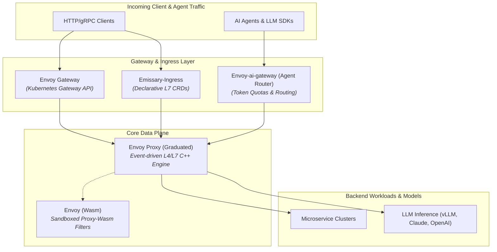
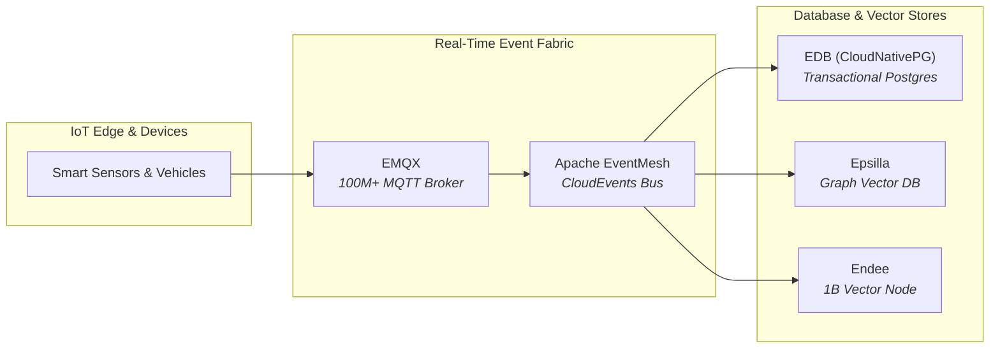

Welcome to the eighth installment of our 52-week cloud-native voyage! Over the course of 2027, we are systematically exploring the Cloud Native Computing Foundation (CNCF) Landscape—from **A to Z**.

After navigating the distributed runtimes and high-performance data engines of **Letter D**, we now arrive at **Letter E**. Spanning **24 verified projects**, Letter E represents the networking nerve center of the entire cloud-native ecosystem. It houses the undisputed titan of modern edge and service proxying (**Envoy**), the emerging Kubernetes Gateway API standard, industrial-scale IoT messaging engines handling tens of millions of concurrent connections, and revolutionary WebAssembly plugin runtimes.

Here is your comprehensive architectural field guide to the 24 tools of Letter E.

---

## 1. The Envoy Empire & CNCF Networking Titans

Modern cloud-native networking would not exist in its current form without the Envoy ecosystem. What started as Lyft's internal C++ proxy has grown into the universal data plane powering global service meshes, enterprise API gateways, and the next wave of AI inference routers.

### [Envoy](https://www.envoyproxy.io) *(CNCF Graduated)*
Originally created at Lyft and hosted by the CNCF as a flagship Graduated project, **Envoy** is the high-performance C++ edge, middle, and service proxy that redefined distributed systems communication. Designed with an asynchronous, event-driven architecture, Envoy delivers blistering throughput with minimal memory overhead. Its revolutionary dynamic discovery APIs (xDS) allow service discovery, routing tables, and security certificates to be updated in real time without restarting processes or dropping a single packet. Today, Envoy forms the foundational data plane for Istio, Kuma, Consul, and thousands of global hyper-scale platforms.

### [Envoy Gateway](https://gateway.envoyproxy.io)
As Kubernetes evolved from legacy `Ingress` resources toward the more expressive, multi-tenant **Kubernetes Gateway API**, **Envoy Gateway** emerged as the official CNCF community standard. It translates Gateway API resources (`GatewayClass`, `Gateway`, `HTTPRoute`, `GRPCRoute`) directly into optimized Envoy xDS configurations. Platform engineers get fine-grained traffic splitting, rate limiting, and cross-namespace routing with zero vendor lock-in.

### [Envoy-ai-gateway](https://aigateway.envoyproxy.io/) *(Agent Router)*
The rapid adoption of Generative AI created a new infrastructure bottleneck: managing API credentials, token-based rate limits, model fallbacks, and cost attribution across dozens of teams and LLM providers. **Envoy-ai-gateway** (formerly known as Agent Router under the Agentic AI Foundation) addresses this directly. It gives application teams a unified, OpenAI-compatible API for any model—whether public endpoints (OpenAI, Anthropic), self-hosted inference clusters (vLLM, Ollama), or Model Context Protocol (MCP) servers—enforcing quotas, caching, and failover using the battle-tested power of Envoy.

### [Envoy (Wasm)](https://www.envoyproxy.io) *(CNCF Graduated)*
Extending proxy functionality previously required writing custom C++ filters and compiling a customized Envoy binary. **Envoy (Wasm)** changes this by integrating WebAssembly runtimes (V8 and Wasmtime) directly into the proxy. Using the standardized `proxy-wasm` ABI, developers can write lightweight, sandboxed L7 filters in Rust, Go, or AssemblyScript, dynamically loading them into live proxies without service interruption.

### [Emissary-Ingress](https://emissary-ingress.dev/) *(CNCF Incubating)*
Formerly known as Ambassador API Gateway, **Emissary-Ingress** is an open-source, Kubernetes-native ingress controller built on Envoy Proxy. Designed specifically for developer self-service, Emissary allows service teams to manage routing rules, timeouts, and authentication policies using declarative Kubernetes Custom Resource Definitions (`Mapping`, `AuthService`, `RateLimitService`) alongside their application manifests.

---

## 2. Edge Traffic Orchestration & Ingress

Beyond the primary Envoy lineage, Letter E features specialized traffic orchestrators and ingress controllers engineered for modularity, Spring Cloud compatibility, and rapid deployment.

### [Easegress](https://megaease.cn/easegress/) *(CNCF Sandbox)*
A cloud-native traffic orchestration system written in Go, **Easegress** serves as an all-in-one reverse proxy, API gateway, and microservice traffic director. Built-in cluster orchestration powered by the Raft consensus algorithm ensures dynamic configuration synchronization across nodes without external datastores. Easegress features a modular pipeline architecture that allows complex request and response transformation workflows, circuit breaking, and WebAssembly plugin extension.

### [EaseMesh](https://megaease.com/easemesh)
Designed to bridge the gap between traditional enterprise Java architectures and modern container infrastructure, **EaseMesh** is a service mesh tailored specifically for the Spring Cloud ecosystem. By utilizing Easegress as a high-performance sidecar and EaseAgent for non-intrusive monitoring, EaseMesh provides full traffic management and mutual TLS without requiring code refactoring.

### [EaseAgent](https://github.com/megaease/easeagent)
A non-intrusive, cloud-native Java agent engineered for APM systems and service meshes. **EaseAgent** leverages Java bytecode manipulation to automatically extract distributed traces, request latencies, and system metrics from popular frameworks (Spring Boot, Kafka, HTTP clients) and export them directly to Zipkin, Jaeger, and Prometheus.

### [EnRoute OneStep Ingress](https://www.getenroute.io)
Designed for teams seeking the performance of Envoy without the operational complexity of complex control planes, **EnRoute OneStep Ingress** packages Envoy into a turnkey Helm deployment. It provides simplified switches for rate limiting, JWT verification, and automated ACME SSL/TLS certificate issuance through Let's Encrypt.

---

## 3. Observability, Search & Analytics

Observability in modern cloud native requires ingesting massive volumes of logs, metrics, and distributed traces while correlating user experience with backend infrastructure.

### [Elastic](https://www.elastic.co/) *(Elasticsearch)*
The legendary distributed search and analytics engine, **Elasticsearch** is the core of the open Elastic Stack. In recent years, Elasticsearch has expanded beyond log analysis and full-text indexing to become a high-performance vector database. With native support for dense vector embeddings, HNSW indexing, and hybrid lexical-semantic search, Elastic serves as both an operational telemetry backend and an enterprise foundation for Retrieval-Augmented Generation (RAG) pipelines.

### [Elastic APM](https://www.elastic.co/observability/application-performance-monitoring)
The application performance monitoring arm of the Elastic Stack, **Elastic APM** collects real-time performance metrics and distributed traces from microservices and translates them into Elasticsearch documents. With native OpenTelemetry Protocol (OTLP) ingestion, Elastic APM allows teams to trace user requests across hybrid polyglot architectures and pinpoint database query bottlenecks.

### [Embrace](https://embrace.io/)
While traditional APM tools focus on backend servers, **Embrace** tackles observability from the user endpoint inward. Built natively on OpenTelemetry standards, Embrace's mobile SDKs (for iOS, visionOS, and Android) capture 100% of mobile sessions, crashes, and network latency, correlating frontend user friction directly with backend cloud traces.

---

## 4. Cloud-Native Data, IoT & Vector Systems

Letter E showcases cutting-edge data architectures ranging from hyper-scale MQTT message brokers to high-density vector databases and enterprise relational operators.

### [EMQX](https://www.emqx.com/en)
For connected vehicles, smart cities, and industrial IoT, scale is measured in tens of millions of concurrent connections. **EMQX** is an ultra-scalable distributed MQTT message broker built on Erlang/OTP's battle-tested actor model. Supporting over 100 million simultaneous MQTT connections on a single cluster with sub-millisecond latencies, EMQX includes a built-in SQL rule engine for filtering, transforming, and streaming real-time IoT events directly into Kafka, S3, or time-series databases.

### [Epsilla](https://epsilla.com)
An open-source vector database engineered for scalability and cost efficiency in Large Language Model applications. **Epsilla** utilizes advanced graph indexing algorithms to achieve dramatic query throughput improvements compared to traditional vector stores, providing an ultra-fast retrieval substrate for long-term agentic memory and RAG workflows.

### [EDB](https://www.enterprisedb.com/) *(CloudNativePG)*
EnterpriseDB (EDB) is the driving force and primary sponsor behind **CloudNativePG (CNPG)**, the CNCF Incubating PostgreSQL operator. EDB brings enterprise database expertise to Kubernetes, providing declarative PostgreSQL cluster provisioning, automated high-availability failover, continuous WAL archiving, and zero-downtime rolling upgrades.

### [Endee](https://endee.io/)
An ultra-high-performance vector database engineered to index and search up to **1 billion vector embeddings on a single bare-metal or cloud node**. By optimizing SIMD instruction execution and memory layout, Endee dramatically slashes the infrastructure footprint required for large-scale embedding retrieval.

### [EventMesh](https://eventmesh.apache.org/) *(Apache EventMesh)*
A new-generation serverless event middleware and dynamic event fabric. Built around the CNCF **CloudEvents** specification, **Apache EventMesh** provides asynchronous event routing, pub/sub bridging, and RPC proxying across heterogeneous message queues (RocketMQ, Kafka, Pulsar, Redis) and multi-cloud serverless environments.

---

## 5. Developer Platforms, Wasm & Secure Infrastructure

The final cluster of Letter E provides essential developer abstractions: universal WebAssembly plugin systems, Kubernetes-native IDE workspaces, and automated node hygiene.

### [Extism](https://extism.org)
WebAssembly offers the promise of safe, sandboxed, cross-language execution, but writing the host-guest integration glue code has historically been challenging. **Extism** solves this as the **universal WebAssembly plugin framework**. With Host SDKs supporting Python, Go, Rust, Node.js, Java, and C#, and Plugin Development Kits (PDKs) for authoring plugins, Extism makes it trivial to embed sandboxed user-extensible plugin architectures into any application.

### [Eclipse Che](https://www.eclipse.org/che/)
A Kubernetes-native developer workspace and Cloud Development Environment (CDE) platform. **Eclipse Che** provisions containerized developer workspaces on demand inside Kubernetes pods, bundling runtimes, compilers, and browser-based IDEs (VS Code / Theia). Driven by declarative `devfile` specifications, Che eliminates the "works on my machine" syndrome across enterprise engineering organizations.

### [Eraser](https://eraser-dev.github.io/eraser/) *(CNCF Sandbox)*
In high-velocity Kubernetes clusters where container images are deployed frequently, worker nodes quickly accumulate hundreds of gigabytes of stale container layers, leading to disk pressure and security vulnerabilities. **Eraser** is a CNCF Sandbox controller that automates the scheduled scanning and removal of non-running and vulnerable container images from all cluster nodes, protecting node storage health.

### [Encore](https://encore.dev)
An open-source backend development engine and infrastructure SDK. **Encore** eliminates infrastructure boilerplate by allowing developers to declare cloud primitives (SQL databases, pub/sub topics, secrets, and cron jobs) directly within type-safe Go and TypeScript code. The Encore engine parses the application architecture graph, coordinates local development with automated tracing, and provisions matching resources directly in AWS or GCP.

### [EJBCA Community](https://www.ejbca.org/)
A robust, enterprise-grade Public Key Infrastructure (PKI) and Certificate Authority (CA) platform. Developed in Java and running across platforms, **EJBCA Community** covers the complete certificate lifecycle—from automated enrollment via ACME, EST, and CMP protocols to revocation and validation—providing an essential building block for Zero Trust identity.

### [Elastisys Welkin® based on Kubespray](https://elastisys.io/welkin)
A compliance-first, certified Kubernetes platform engineered for highly regulated European environments (GDPR, ISO 27001, NIS2). Automated via Kubespray and Ansible, **Welkin** packages Kubernetes with pre-configured security guardrails, Falco runtime protection, OPA Gatekeeper policies, and automated audit logging.

### [Easy-Ngo](https://netease-media.github.io/easy-ngo-website/)
An enterprise Go microservice toolkit open-sourced by NetEase Media. **Easy-Ngo** packages RPC communication, connection pooling, automated metric instrumentation, and configuration management into a unified framework designed for high-concurrency production workloads.

---

## 🔭 Weekly Takeaway: The Convergence of L7 Traffic & Intelligent Runtimes

Reflecting on the 24 projects of Letter E reveals a major architectural trend shaping cloud native in 2027:

> **The convergence of API routing, WebAssembly extensibility, and AI inference gateways.**

Networking is no longer just about load balancing TCP packets or forwarding HTTP headers. Today's data plane—epitomized by **Envoy Gateway**, **Envoy-ai-gateway**, and **Extism**—is an intelligent runtime capable of enforcing token budgets, caching LLM completions, and running dynamic Wasm plugins at the network edge.

Next week, our voyage continues into **Letter F**, where we will explore container networking with Flannel, high-performance web extraction with Firecrawl, and microservice load benchmarking with Fortio!

---

*Which Letter E project is running in your production stack? Join the conversation on [GitHub](https://github.com/mekitmedia/cncf-landscape-a-to-z) and explore the full landscape A to Z!*
