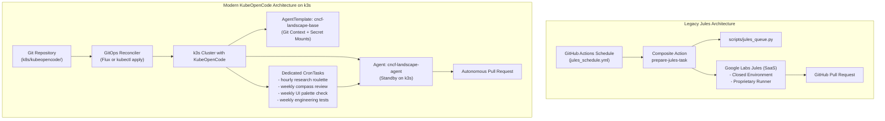

A few months ago, I wrote about [putting Google Jules to work](/posts/putting-jules-to-work/), exploring the concept of **Task as Code**: checking markdown prompts and task backlogs directly into Git, and having an asynchronous agent pick them up via scheduled GitHub Actions to generate reviewable pull requests.

It was an eye-opening experiment. It proved that background, asynchronous agents shift the human engineer’s role from active typist to code reviewer. But relying on an experimental cloud service always carries a familiar cloud-native risk: **service deprecation and lack of infrastructure control**.

When Jules reached end-of-life, I didn't want to abandon the Task-as-Code philosophy. Instead, I wanted to take it to its logical cloud-native conclusion: **self-hosting my autonomous agents on my own Kubernetes (k3s) cluster, declarative configuration via Custom Resource Definitions (CRDs), and continuous GitOps synchronization with Flux**.

Here is why and how we migrated from Google Jules to **[KubeOpenCode](https://github.com/kubeopencode/kubeopencode)**, and how you can convert your own repositories to run self-hosted, scheduled coding agents.

---

## Why We Changed: From SaaS Blackbox to Kubernetes Primitives

Operating Jules via GitHub Actions gave us a taste of autonomous repository maintenance, but it also exposed several structural limitations:

1. **Service Deprecation & Proprietary Lock-In**: Proprietary cloud agents can be altered or shut down without recourse. A developer-agent platform should be open source, reproducible, and under your own control.
2. **Ephemeral Execution & Quota Constraints**: In GitHub Actions, each Jules run had to spin up runners from scratch, rely on external API keys, and work within third-party rate limits.
3. **Environment Isolation**: Jules ran in Google's managed sandbox. We couldn't easily customize the underlying container toolchains, install specialized OS packages, or tap into private cluster services.
4. **Scattered Automation**: Scheduled cron workflows were duplicated across `.github/workflows/`, tightly bound to GitHub Actions infrastructure rather than declarative infrastructure-as-code.

### The New Paradigm: KubeOpenCode on k3s

To replace Jules, I deployed **KubeOpenCode** onto an existing lightweight **k3s cluster**. KubeOpenCode turns autonomous AI agents into first-class Kubernetes citizens (`apiVersion: kubeopencode.io/v1alpha1`).

Instead of a SaaS platform calling GitHub webhooks, the cluster hosts the runtime:
- **`AgentTemplate`**: A shared blueprint for execution environments (container images, credentials, model parameters, Git contexts).
- **`Agent`**: A running or standby agent instance with persistent workspace sessions.
- **`CronTask`**: A Kubernetes-native cron scheduler (analogous to `CronJob`, but creating agent `Tasks`) that triggers background jobs on a recurring schedule.



---

## The Core Concept: Each Repo Defines Its Agent & Schedule

In this architecture, the k3s cluster runs the KubeOpenCode operator once. From there, **each repository owns its own agent definitions and schedules as declarative building blocks**.

Whether you deploy them using `kubectl apply -k` or let **Flux** reconcile them from an external cluster-management repository, the target repo contains only standard Kubernetes manifests:

```
k8s/
├── kustomization.yaml                               # Root kustomization
└── kubeopencode/
    ├── kustomization.yaml                           # Component kustomization
    ├── agent-template.yaml                          # Base AgentTemplate
    ├── agents.yaml                                  # Agent instances
    ├── crontask-weekly-research-hourly.yaml          # Hourly research roulette
    ├── crontask-compass-improvement-weekly.yaml      # Weekly compass review
    ├── crontask-palette-improvement-weekly.yaml      # Weekly palette UI/UX check
    └── crontask-engineering-improvement-weekly.yaml  # Weekly engineering maintenance
```

No custom queue scripts. No fragile composite GitHub actions. Just standard Kubernetes manifests.

---

## How to Convert: Jules vs. KubeOpenCode Mapping

Here is how each piece of the Jules system translates into KubeOpenCode:

| Jules Component | KubeOpenCode Replacement | Where It Lives |
|---|---|---|
| **Jules Web / SaaS Agent** | `AgentTemplate` + `Agent` | `k8s/kubeopencode/agent-template.yaml` |
| **Scheduled Actions** (`jules_schedule.yml`) | `CronTask` resources (one per file) | `k8s/kubeopencode/crontask-*.yaml` |
| **GitHub Secrets** (`JULES_API_KEY`) | Kubernetes Secrets (`github-creds`, `google-creds`) | Mounted in Pod via `credentials[]` |
| **GitHub Action Checkout** | Git Context with `sync: HotReload` | Handled automatically by OpenCode `git-sync` |
| **Agent Prompt Files** | `CronTask.spec.taskTemplate.spec.description` | Stored directly in YAML specs |
| **`.Jules/` Domain Memory** | `docs/domain-memory/` | Discovered as knowledge context in workspace |
| **Custom Queue CLI** (`jules_queue.py`) | In-repo `just` targets (`just draw`, `just test`) | Executed inside the agent pod |

---

## Step-by-Step Conversion Guide

### Step 1: Define the Reusable `AgentTemplate`

The `AgentTemplate` serves as the blueprint for the agent's runtime environment. It configures the container images, mounts your Git repository via a self-syncing Git context, injects API secrets, and configures the LLM.

Notice that we use the floating model alias **`google/gemini-flash-lite-latest`**—delivering near-instant response times at minimal token cost:

```yaml
# k8s/kubeopencode/agent-template.yaml
apiVersion: kubeopencode.io/v1alpha1
kind: AgentTemplate
metadata:
  name: cncf-landscape-base
  namespace: kubeopencode
spec:
  agentImage: ghcr.io/kubeopencode/kubeopencode-agent-opencode:latest
  executorImage: ghcr.io/kubeopencode/kubeopencode-agent-devbox:latest
  attachImage: ghcr.io/kubeopencode/kubeopencode-agent-attach:latest
  workspaceDir: /workspace
  serviceAccountName: kubeopencode-agent

  # Mount repository via Git Context with auto-sync
  contexts:
    - name: repository
      type: Git
      git:
        repository: https://github.com/mekitmedia/cncf-landscape-a-to-z.git
        ref: main
        sync:
          enabled: true
          interval: 5m
          policy: HotReload
      mountPath: .

  # Credentials mounted from Kubernetes Secrets
  credentials:
    - name: github-token
      secretRef:
        name: github-creds
        key: token
      env: GITHUB_TOKEN
    - name: google-api-key
      secretRef:
        name: google-creds
        key: api-key
      env: GOOGLE_API_KEY

  # Floating fast model configuration
  config:
    $schema: https://opencode.ai/config.json
    model: google/gemini-flash-lite-latest
    small_model: google/gemini-flash-lite-latest

  podSpec:
    securityContext:
      runAsNonRoot: true

  maxConcurrentTasks: 3
  quota:
    maxTaskStarts: 20
    windowSeconds: 3600
```

### Step 2: Instantiate the `Agent`

Next, create an `Agent` instance referencing the template. We configure `standby.idleTimeout: 30m` so the agent pod scales down when idle to conserve cluster memory:

```yaml
# k8s/kubeopencode/agents.yaml
apiVersion: kubeopencode.io/v1alpha1
kind: Agent
metadata:
  name: cncf-landscape-agent
  namespace: kubeopencode
spec:
  templateRef:
    name: cncf-landscape-base
  profile: "CNCF Landscape A-to-Z Autonomous Research and Engineering Agent"
  standby:
    idleTimeout: "30m"
```

### Step 3: Split Scheduled Workflows into Dedicated `CronTask` Files

One of our main learnings from running scheduled tasks is that **each recurring job deserves its own dedicated file**. Rather than bundling four distinct schedules into one giant document, we split them into standalone manifests:

#### 1. Hourly Research Roulette (`crontask-weekly-research-hourly.yaml`)
Replaces the old `jules_schedule.yml`. It runs hourly at minute 23 (`23 * * * *`), draws the next project task using `just draw`, conducts research, and runs validation:

```yaml
apiVersion: kubeopencode.io/v1alpha1
kind: CronTask
metadata:
  name: cncf-weekly-research-hourly
  namespace: kubeopencode
spec:
  schedule: "23 * * * *"
  concurrencyPolicy: Forbid
  maxRetainedTasks: 10
  taskTemplate:
    spec:
      agentRef:
        name: cncf-landscape-agent
      description: |
        Perform autonomous weekly CNCF Landscape project research:
        1. Draw a task from the weighted roulette / ad-hoc queue:
           just draw
        2. Conduct in-depth research according to `.agents/skills/cncf-weekly-content/SKILL.md`.
        3. Write structured research YAML under `data/weeks/<week_id>/research/<project_name>.yaml`.
        4. Validate data contracts:
           just validate
        5. Verify unit tests pass:
           just test
        6. Commit changes and push or open a pull request.
```

#### 2. Weekly Compass Audit (`crontask-compass-improvement-weekly.yaml`)
Runs every Tuesday at 09:00 UTC (`0 9 * * 2`) to review tool gaps and category indexes.

#### 3. Weekly Palette UI/Accessibility Review (`crontask-palette-improvement-weekly.yaml`)
Runs every Thursday at 09:00 UTC (`0 9 * * 4`) to review theme accessibility, tabindex management, and semantic navigation.

#### 4. Weekly Engineering Maintenance (`crontask-engineering-improvement-weekly.yaml`)
Runs every Saturday at 09:00 UTC (`0 9 * * 6`) to run the pytest suite and refactor codebase technical debt.

### Step 4: Aggregate in `kustomization.yaml`

Group your building blocks together using standard Kustomize:

```yaml
# k8s/kubeopencode/kustomization.yaml
apiVersion: kustomize.config.k8s.io/v1beta1
kind: Kustomization

resources:
  - agent-template.yaml
  - agents.yaml
  - crontask-weekly-research-hourly.yaml
  - crontask-compass-improvement-weekly.yaml
  - crontask-palette-improvement-weekly.yaml
  - crontask-engineering-improvement-weekly.yaml
```

---

## Deploying via `kubectl` or Reconciling via Flux

Because these manifests are pure Kubernetes building blocks with zero proprietary packaging, you have complete flexibility in how you deploy them:

### Option A: Direct Apply via `kubectl`
```bash
kubectl apply -k k8s/kubeopencode/
```

### Option B: Pointing Flux from Your Management Repo
If you maintain a separate GitOps cluster repository with Flux, you simply declare a `Kustomization` pointing to this repository’s path:

```yaml
apiVersion: kustomize.toolkit.fluxcd.io/v1
kind: Kustomization
metadata:
  name: cncf-landscape-agents
  namespace: flux-system
spec:
  interval: 10m
  path: ./k8s/kubeopencode
  prune: true
  sourceRef:
    kind: GitRepository
    name: cncf-landscape-a-to-z
  targetNamespace: kubeopencode
```

Flux continuously synchronizes the `AgentTemplate`, `Agent`, and `CronTasks` whenever you merge changes to `main`.

---

## Preserving Agent Learnings: Domain Memory

With Jules, learnings were stored in `.Jules/palette.md`, `.Jules/content.md`, and `.Jules/engineering.md`.

When ditching Jules, we didn't want to throw away those hard-earned lessons (like Hugo Google Analytics partial quirks or smart-quote regex normalizations). We migrated them directly into the repository documentation at `docs/domain-memory/`:
- `docs/domain-memory/palette.md`
- `docs/domain-memory/content.md`
- `docs/domain-memory/engineering.md`

Because KubeOpenCode mounts the repository root directly into `/workspace`, the agent can inspect these memory files during execution just like any other project documentation.

---

## Conclusion: The Power of Self-Hosted Task as Code

Switching from a closed SaaS agent to self-hosted KubeOpenCode on k3s delivered four immediate wins:
1. **Zero Lock-In**: Everything is open source and runs entirely on our own infrastructure.
2. **Deterministic Scheduling**: `CronTask` gives us Kubernetes-native scheduling with clean concurrency control (`Forbid`, `Replace`, `Allow`).
3. **Floating Lightweight Models**: Using `google/gemini-flash-lite-latest` gives fast, responsive agent executions with minimal operational cost.
4. **Pure GitOps**: Adding a new scheduled agent or tweaking prompts is as simple as submitting a PR to `k8s/kubeopencode/`.

If you have an existing k3s or Kubernetes cluster and want to put autonomous agents to work across your repositories, give [KubeOpenCode](https://github.com/kubeopencode/kubeopencode) a look. It brings the promise of Task-as-Code home to where it belongs: your own cluster.
